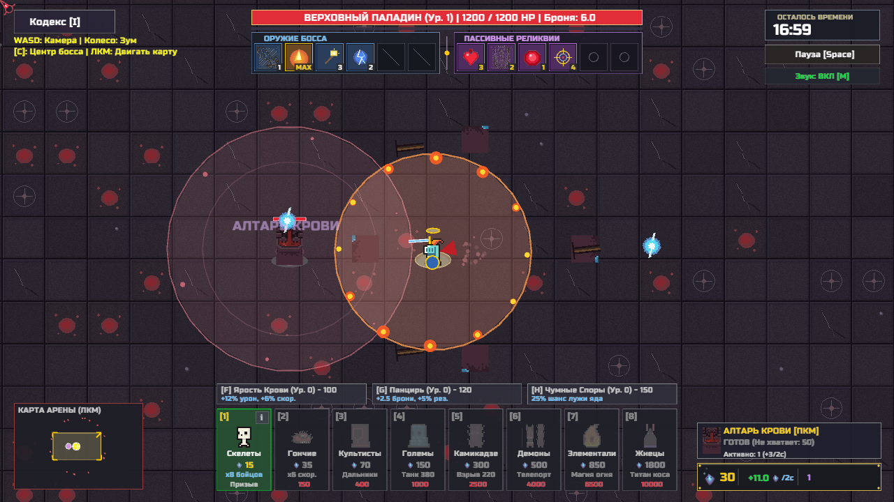
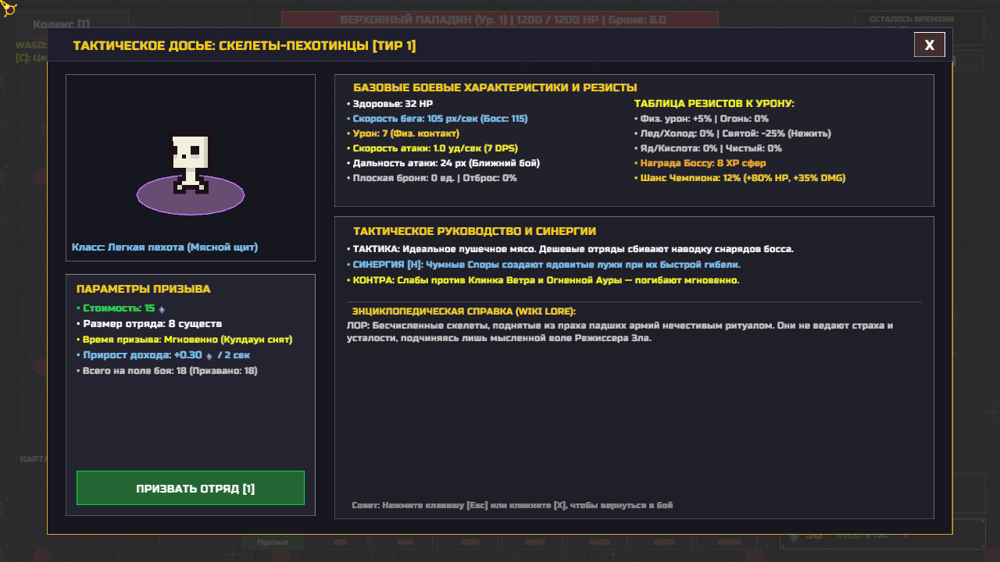
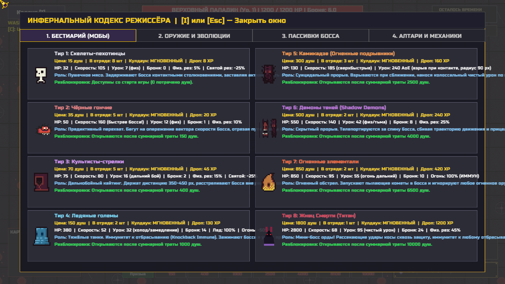
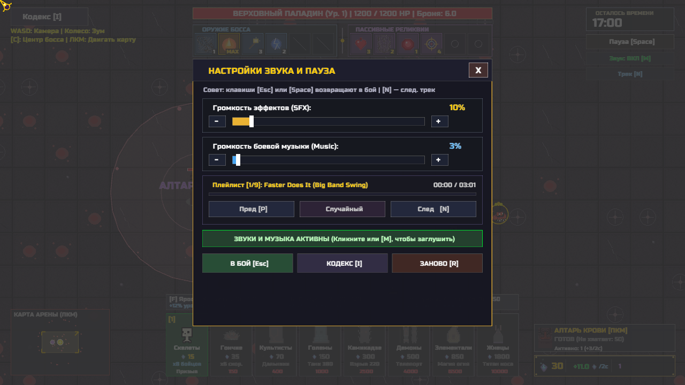

# Reverse Survivor: The Director

[](LICENSE)
[](https://www.rust-lang.org/)
[]()
[]()



**Reverse Survivor: The Director** — это тактический стратегический Auto-Battler в жанре Reverse Bullet Hell на высокопроизводительном движке **Rust** + **Macroquad**.

В отличие от классических Survivor-игр, здесь можно играть за **Инфернального Режиссёра** или за **Босса**. Меню позволяет выбрать сторону; в режиме Босса противником управляет обученная модель Директора. Политики Босса и Директора совместно улучшаются эволюционным поиском по ноль-суммовой награде. Сеть Босса получает 182 признака и имеет 15,175 параметров; многоголовая сеть Директора получает 177 признаков и имеет 16,815 параметров.

---

## 📸 Скриншоты интерфейса

| Тактическое Досье существа (Энциклопедия) | Инфернальный Кодекс (Бестиарий и механики) | Настройки звука и пауза (Esc) |
|---|---|---|
|  |  |  |

---

## 🎮 Управление в игре

В главном меню можно задать ник длиной до 32 символов, выбрать один из пяти цветовых обликов и переназначить клавиши движения и рывка. Над Боссом отображается его ник.

### 👾 Призыв отрядов монстров (16 Тиров: Орда и Легион)

Переключение страниц отрядов: клавиша **`[Tab]`** или кнопки **`[ОРДА 1-8]`** / **`[ЛЕГИОН 9-16]`** на панели найма.

#### Страница 1: Инфернальная Орда (Тиры 1–8)
| Клавиша / Мышь | Существо | Стоимость | Описание и роль |
|---|---|---|---|
| **`[1]`** или **`ЛКМ`** | **Скелеты-пехотинцы** | 15 душ | Дешёвое пушечное мясо (8 бойцов), сбивает наводку снарядов |
| **`[2]`** или **`ЛКМ`** | **Чёрные гончие** | 35 душ | Стремительные преследователи (+39% быстрее босса!), перехват вектора |
| **`[3]`** или **`ЛКМ`** | **Культисты-стрелки** | 70 душ | Дальнобойный кайтинг (дистанция 320 px), вынуждают тратить Рывок |
| **`[4]`** или **`ЛКМ`** | **Ледяные големы** | 150 душ | Тяжёлые танки (380 HP, 14 брони), иммунитет к отбросу, замедление |
| **`[5]`** или **`ЛКМ`** | **Камикадзе** | 300 душ | Сверхбыстрый суицидальный прорыв (220 чистый сплэш, радиус 95 px) |
| **`[6]`** или **`ЛКМ`** | **Демоны теней** | 500 душ | Фазовый скачок за спину босса каждые 4.5с, сбивают прицел |
| **`[7]`** или **`ЛКМ`** | **Огненные элементали** | 850 душ | Артиллерийские кометы на 360 px, 100% иммунитет к огню |
| **`[8]`** или **`ЛКМ`** | **Жнец Смерти (Титан)** | 1800 душ | Мини-босс орды (2800 HP), рассекающие удары косы сквозь броню |

#### Страница 2: Высший Легион (Тиры 9–16)
| Клавиша / Мышь | Существо | Стоимость | Описание и роль |
|---|---|---|---|
| **`[1]`** [на стр. 2] | **Дред-Фаланга** | 350 душ | Непробиваемый строй легионеров со щитами (100% иммунитет к отбросу) |
| **`[2]`** [на стр. 2] | **Адские Церберы** | 650 душ | Огненная стая (+56% быстрее босса!), сокрушительные огненные челюсти |
| **`[3]`** [на стр. 2] | **Архикультисты Бездны** | 1100 душ | Снайперы на 380 px: самонаводящиеся сгустки чистой темной материи |
| **`[4]`** [на стр. 2] | **Обсидиановые Колоссы** | 2200 душ | Сверхтяжелые бастионы (1450 HP, 30 брони), поглощают сотни снарядов |
| **`[5]`** [на стр. 2] | **Проклятые Мучители** | 3500 душ | Ядерные камикадзе со сверхзвуковой скоростью 205 px/с и 550 чистым сплэшем |
| **`[6]`** [на стр. 2] | **Призрачные Ловчие** | 5500 душ | Высшие демоны мрака (1800 HP), фазовый сдвиг сквозь преграды к боссу |
| **`[7]`** [на стр. 2] | **Солнечные Архонты** | 8500 душ | Падшие серафимы (2600 HP): кометы на 440 px со 140 уроном по площади |
| **`[8]`** [на стр. 2] | **Аватар Забвения (Колосс)** | 18000 душ | Верховный владыка Бездны! 8500 HP, 45 брони, сокрушительные волны смерти |

| Специальные комбинации | Действие |
|---|---|
| **`[Tab]`** | Быстрое переключение между страницами отрядов (Орда 1-8 <-> Легион 9-16) |
| **`Shift + [1..8]`** | Мгновенно расходует всю доступную казну на спам выбранного тира активной страницы |
| **Кнопка `[i]`** | Открывает подробнейшее Тактическое Досье существа (HP, урон, DPS, скорость, резисты, ЛОР) |

### 🩸 Глобальные инфернальные ауры (Апгрейды армии)
* **`[F]`** — **Ярость Крови** (Базовая цена: 100 душ): $+12\%$ к общему урону и $+6\%$ к скорости передвижения всех миньонов.
* **`[G]`** — **Костяной Панцирь** (Базовая цена: 120 душ): $+2.5$ к плоской броне и $+5$ процентных пунктов физического сопротивления мобов и структур.
* **`[H]`** — **Чумные Споры** (Базовая цена: 150 душ): $+25\%$ шанс создания ядовитой лужи при гибели существа.
* **`Shift + [F / G / H]`** — **Прокачка на все деньги**: улучшает соответствующую ауру на максимальное доступное число уровней.

### 🗺️ Навигация и системные функции
* **`ПКМ` (Клик правой кнопкой)** — Возвести **Алтарь Крови** (50 душ) в точке курсора.
* **`ЛКМ` (Зажать и вести по арене)** — Плавное панорамирование (перетаскивание) карты мышью.
* **`ЛКМ` по Миникарте** — Мгновенный переход камеры в выбранную область арены.
* В режиме Директора **WASD** и стрелки двигают камеру; в режиме Босса **WASD** двигает Босса, а стрелки — камеру.
* **`Shift` (Зажать)** — Ускоренный полёт камеры.
* **`Колёсико мыши`** — Плавный зум арены (от 0.4x до 2.0x).
* **`[C]`** — Центрировать камеру на Боссе.
* **`[Esc]`** — Пауза матча.
* **`[Space]`** — Рывок в режиме Босса; клавишу можно переназначить в главном меню.
* **`[M]`** — Переключить звук (ВКЛ / ВЫКЛ, кнопка в правом верхнем углу под паузой).
* **`[N]`** — **Следующий трек** динамического боевого плейлиста (также кнопка `[N]` в верхнем правом углу).
* **`[P]`** — **Предыдущий трек** плейлиста.
* **`[I]`** — Открыть / закрыть **Инфернальный Кодекс** (полная энциклопедия).
* **`[R]`** — Мгновенный перезапуск матча (со случайным новым стартовым треком плейлиста).
* **`[Esc]`** — Меню паузы и тонкой настройки звука, громкости SFX / музыки и переключения треков плейлиста.

---

## ⚙️ Условия победы и таймер

- **Лимит раунда:** **17:00 минут** (цифровой таймер обратного отсчёта справа сверху).
- **Победа Директора:** Здоровье Босса опустилось до 0 HP до истечения времени.
- **Победа Босса:** Босс сумел пережить осаду и выжил все 17 минут.

---

## 📈 Экономика «Spend to Grow» и Алтари Крови

1. **Мгновенный призыв:** Все кулдауны на призыв сняты — тратьте души с любой скоростью!
2. **Пассивный доход:** Каждые 2.0 секунды казна Директора пополняется на величину текущего дохода.
3. **Разгон казны (Spend to Grow):**
   $$\Delta \text{Доход} = \text{Стоимость покупки} \times 0.02$$
   Каждая потраченная сотня душ навсегда поднимает ваш постоянный прирост на $+2.0$ душ / 2 сек.
4. **Алтари Крови (ПКМ):**
   - Дают мощный дополнительный пассивный доход ($+3.0$ душ / 2 сек за каждый активный алтарь).
   - Проецируют **исцеляющую ауру радиусом 180 px**, восстанавливающую здоровье находящихся рядом миньонов.
   - Координаты всех четырёх обелисков и признак активности доступны политике Босса. Навигация не принуждает его идти к обелиску; неактивные обелиски не получают урон. Уничтожение алтарей и деактивация активного обелиска дают Боссу игровые награды и ограниченный бонус в fitness.
   - **Алтари тиров 1–16:** удерживайте `Ctrl` и нажмите `Q/W/E/R/A/S/D/F` (тиры 1–8) или `Z/X/C/V/G/H/Y/U` (тиры 9–16). Выбранный алтарь сразу переходит в режим размещения; стоимость и личный кулдаун каждого тира независимы. Алтарь спавнит моба своего тира и становится прочнее с ростом тира. На каждом алтаре показан портрет соответствующего моба из ресурсов игры.

---

## 🧠 Интеллект Босса

Босс — автономный боевой агент. Его сеть управляет движением, скоростью, рывком и остановкой. Политики ищутся эволюционным отбором и мутацией по итогам матчей; нейросетевые веса наследуются от одного родителя, а обычные генетические приоритеты смешиваются. Это black-box policy search, а не обучение градиентом по шагам.

1. **Сенсорная система Dual-Ring (182 входа):**
   - **4-канальная пространственная сетка $5 \times 5$ (100 входов)**: независимые каналы для мобов, вражеских снарядов, опасных зон/миазм и стен арены.
   - **Макро-радар дальних угроз (16 секторов)**: обнаружение групп мобов на дистанции 250–600 px.
   - **Предсказание траектории снарядов**: время до ближайшего сближения с учетом относительной скорости и дистанция промаха.
   - **Навигация и стратегические маяки**: точные координаты, дистанции и расчетное время прибытия (ETA) до ближайших Алтарей Крови и сфер-Магнитов; координаты и статус активности всех четырёх обелисков.
   - **Пространственные признаки угроз**: локальная плотность мобов, число ближних мобов, стрелков и элит.
   - **Внутреннее состояние**: здоровье, броня, кулдаун рывка, уровень и опыт, скорость, медитация, недавний урон и яд.
   - **Союзники в кооперативе**: относительные координаты, HP и статус четырёх ближайших Боссов.
2. **Нейронная топология (15,175 параметров):**
   - Архитектура: $182 \to 64 \to 48 \to 7$ с Leaky ReLU и инициализацией He.
   - **7 выходов управления**:
     - `OUT_MOVE_X`, `OUT_MOVE_Y` — направление бега.
     - `OUT_MOVE_MAG` — выбор полного бега или остановки.
     - `OUT_DASH_TRIGGER` — осознанная активация Рывка спасения.
     - `OUT_DASH_X`, `OUT_DASH_Y` — независимый вектор направления рывка (босс может прыгать в сторону/назад, стреляя вперед).
     - `OUT_REST` — канал намерения войти в ауру восстанавливающей медитации.
3. **Тактический Рывок Спасения:**
   - Сеть выбирает направление рывка на 180 px. Во время рывка Босс получает краткую неуязвимость, уничтожает часть снарядов и наносит урон мобам рядом с точкой приземления.
4. **Аура медитации:**
   - Если босс сознательно сбрасывает скорость и не получает урона более 2 секунд, он входит в транс: восстанавливает $+2\%$ HP/сек и накапливает опыт.
5. **Адаптивный драфт синергий и Limit Break:**
   - Эволюционно настраиваемые приоритеты выбора перков учитывают 6 синергетических архетипов; после полной эволюции всех слотов доступен Limit Break.

---

## ⚔️ Полная линейка Эволюций Оружия (20x20)

Для получения совершенного оружия босс прокачивает базовое оружие до 8 уровня и берёт соответствующую пассивную реликвию:

| Базовое оружие (8 ур.) | Необходимая пассивка | Эволюция (MAX) | Эффект совершенного оружия |
|---|---|---|---|
| **Клинок Ветра** | **Перчатка Скорости** | **Буря Клинков** | Круговой шторм из 8 клинков с мощным отталкиванием |
| **Огненная Аура** | **Сердце Гиганта** | **Адское Пекло** | Процентный урон по площади ($+10\%$ от макс. HP цели) + детонация трупов |
| **Магический Жезл** | **Фолиант Времени** | **Луч Смерти** | Прожигающий непрерывный лазер сквозь всю арену |
| **Святой Молот** | **Броня Света** | **Праведный Щит** | 3 вращающихся щита, сбивающих снаряды, с $5\%$ вампиризмом |
| **Ледяные Осколки** | **Кольцо Заморозки** | **Ледниковая Буря** | Тотальная глубокая заморозка в радиусе 210 px |
| **Чумные Сферы** | **Едкий Сосуд** | **Токсичный Мор** | Расползающиеся едкие лужи, растворяющие броню целей |
| **Топор Палача** | **Кровавый Камень** | **Вихревой Секач** | Спираль из гигантских зазубренных секачей с эффектом кровотечения |
| **Небесный Лук** | **Орлиный Прицел** | **Звездопадный Залп** | Конус из 8 пронзающих звездных стрел со взрывами света |
| **Грозовая Сфера** | **Песочные Часы** | **Гнев Грозы** | Каскад разрушительных молний по всей арене с шоковым оглушением |
| **Кровавые Кинжалы** | **Сфера Притяжения**| **Кровавая Жатва** | Веер кровавых лезвий с $20\%$ вампиризмом здоровья |
| **Гравитационная Сфера**| **Катушка Теслы** | **Горизонт Событий** | Колоссальная червоточина, затягивающая орды мобов и бьющая молниями |
| **Цепной Ледяной Шар**| **Клевер Судьбы** | **Абсолютный Ноль** | Каскад ледяных сфер с бесконечными отскоками и критическим уроном |
| **Кровавый Гиперлуч** | **Призматический Фокус** | **Инфернальный Катаклизм** | Вращающийся крест из 4 плазменных лучей с колоссальной зоной поражения |
| **Рой Микроракет** | **Черный Эгис** | **Осада Судного Дня** | Ураганный залп тяжелых кассетных ракет с мощнейшей защитой носителя |
| **Цепная Молния** | **Катушка Теслы** | **Тесла-Шторм** | Непрерывная цепная буря на 12 целей со статическим шоком на 2.0 сек |
| **Колокол Собора** | **Благословенное Ядро** | **Аура Величия** | Молитвенный купол чистого урона (120 DPS) и щит на 150 HP |
| **Призрачные Фантомы** | **Призрачный Сосуд** | **Армия Призраков** | 6 неуязвимых призраков-защитников, блокирующих напор мобов |
| **Бастион Эгиды** | **Эгида Бессмертия** | **Несокрушимая Крепость**| 8 вращающихся щитов-клинков: 100% отражение всех дальних снарядов |
| **Метеорит Хаоса** | **Октариновое Ядро** | **Армагеддон** | Залп из 5 метеоритов: кратеры с магмой на 8 секунд |
| **Разрыв Бездны** | **Ткач Судеб** | **Черная Дыра Бездны** | Пространственный разрыв: затягивает, дробит и аннигилирует титанов |

---

## 👑 Пассивные предметы и Легендарные Реликвии (28 видов)

| Тип | Предмет | Эффект и кросс-синергии |
|---|---|---|
| **Базовый (1–14)** | **Перчатка Скорости** | $-10\%$ времени отката атак за уровень (до $-50\%$) |
| | **Сердце Гиганта** | $+25\%$ к макс. HP и $+3.0$ HP/сек регенерации за уровень |
| | **Фолиант Времени** | $-8\%$ ко всем кулдаунам оружия и Рывка (Dash) за уровень |
| | **Броня Света** | $+3$ к плоской броне и $+8\%$ сопротивления физ. урону |
| | **Кольцо Заморозки**| $+20\%$ к радиусу замедления и силе заморозки |
| | **Едкий Сосуд** | Игнорирует $15\%$ брони врагов и продлевает действие луж яда |
| | **Кровавый Камень** | $+12\%$ к общему урону и $+2.5$ HP/сек регенерации |
| | **Орлиный Прицел** | $+20\%$ к скорости и дальности полета снарядов |
| | **Песочные Часы** | $+25\%$ длительности всех стихийных эффектов (лед, огонь, яд) |
| | **Сфера Притяжения**| $+45$ px к радиусу притяжения кристаллов душ |
| | **Катушка Теслы** | $+12\%$ шанс возникновения цепной молнии на 3 цели |
| | **Клевер Судьбы** | $+12\%$ шанс нанесения критического удара ($\times 2.0$ урон) |
| | **Призматический Фокус**| $+15\%$ к радиусу области поражения (AoE) всех заклинаний |
| | **Черный Эгис** | $-2.5$ плоского входящего урона от каждого удара за уровень |
| **Легендарный (15–28)**| **Октариновое Ядро** | $+25\%$ к скорости перезарядки и $+6\%$ вампиризм от всех заклинаний |
| | **Священная Рапира** | $+50\%$ ко всему наносимому урону и $+35\%$ пробития брони |
| | **Солнечная Реликвия**| $+40$ Святого урона в секунду всем врагам в радиусе 220 px |
| | **Ткач Судеб** | $+1$ дополнительный снаряд ко всем атакам и $+15\%$ шанс крита |
| | **Эгида Бессмертия** | **ВОСКРЕШЕНИЕ:** При гибели восстанавливает $100\%$ HP, дарует 3с неуязвимости и отбрасывает орду |
| | **Око Колосса** | $+50\%$ к размеру всех снарядов и $+2$ дополнительных пробития сквозь строй |
| | **Призрачный Сосуд** | $+25\%$ к макс HP и призывает 2 постоянных призраков-защитников |
| | **Осколок Архимага** | $+20\%$ к урону заклинаний, все снаряды пробивают $+1$ цель |
| | **Сердце Пепла** | $+30\%$ к огненному урону, поджигает врагов и восстанавливает $8\%$ HP |
| | **Ядро Буревестника**| $+20\%$ к урону молний, оглушает мобов на 0.4 сек |
| | **Мортира Бедствия** | $+40\%$ к урону по площади (AoE), сокрушает ряды наступающих |
| | **Резонирующие Струны**| $+25\%$ к радиусу поражения, враги резонируют на 30 урона вокруг |
| | **Благословенное Ядро**| $+35\%$ к эффективности лечения и регенерации, $+4$ к броне |
| | **Сияющий Нимб** | $+20\%$ к урону святостью, ослепляет врагов в радиусе 160 px |

---

## ⚡ Запредельное Возвышение (Limit Break — Бесконечная прокачка после 10-й минуты)

Когда все 6 слотов оружия эволюционировали до максимума, а пассивные реликвии заполнены, прогресс Босса не останавливается! Система **Limit Break** открывает бесконечные уровни усиления:

* **+Снаряды к оружию (`+Projectiles`):** Добавляет дополнительный снаряд к каждому залпу выбранного слота (позволяет стрелять десятками ракет, клинков или лучей).
* **Сверх-урон оружия (`+Damage`):** Увеличивает урон выбранного оружия на $+10\%$ за каждый уровень Limit Break.
* **Сверх-ускорение отката (`-Cooldown`):** Сокращает время перезарядки оружия на $-8\%$ (вплоть до пулемётного минимума 0.10 сек).
* **Титаническая Сила (`Titan Vigor`):** $+80$ к максимальному запасу здоровья босса и мгновенное восстановление 150 HP прямо в бою.
* **Адаптивная Броня (`Adaptive Armor`):** $+2.0$ к постоянной плоской броне и $+3\%$ ко всем видам стихийного сопротивления.
* **Инстинкт Хищника (`Predator Speed`):** $+12$ px/sec к скорости бега босса и $+5\%$ к шансу уклонения от ударов.

> Уровни Limit Break отображаются в интерфейсе специальным фиолетово-золотым бейджем (например, `+1`, `+3`, `+12`) прямо на иконках снаряжения, а в подсказках подробно рассчитывается накопительный бонус.

---

## 🤖 Со-эволюционный турнир ИИ

В игру встроен headless-симулятор для параллельного поиска политик Босса и Директора через матчи друг с другом и с архивом прежних моделей:

* **Ноль-суммарная полезность матча:**
  Босс и Директор получают противоположные оценки одного и того же матча:
  $$R_{\text{boss}} = -R_{\text{director}}$$
  Единая функция полезности учитывает выживание, нанесённый урон, уничтожение босса, аптайм Алтарей Крови и экономическую эффективность:
  $$\text{Utility} = \text{TimeReward (600)} + \text{KillBonus (400)} + \text{DamageShare (200)} + \text{AltarUptime (150)} + \text{EconomyEfficiency (50)} - \text{BossLevel (100)}$$
  Это исключает сговор агентов и стимулирует бескомпромиссную адаптацию.
* **Зал стратегий:** В архиве хранится до 12 прежних политик каждого типа; текущий лидер периодически заменяет участника архива.
* **Параллельные матчи:** Rayon's thread pool запускает независимые матчи одновременно. По умолчанию Босс принимает решение на каждом тике симуляции (20 Гц); `--think-ms 100` или `--think-ms 200` снижает частоту, если процессор становится узким местом. В обычной игре модель решает раз в 0.2 секунды.
* **Warm Start (Чекпоинты):** Обучение автоматически подхватывает сохранённый чекпоинт из `models/boss_policy.json` и `models/director_policy.json`, продолжая эволюцию именно с последнего поколения.

### Выбор длительности раунда (Спринт 300 сек vs Марафон 1020 сек):

При запуске обучения доступен гибкий выбор длительности симуляции матчей:
1. **Быстрый спринт (300 секунд / 5.0 минут на матч):**
   Идеально для быстрой отладки, активного перебора мутаций и агрессивного обучения ранней фазе боя.
2. **Полный марафон (1020 секунд / 17.0 минут на матч):**
   Полный турнирный регламент игры с глубоким лейтгеймом, раскрытием всех 20 эволюций оружия и Limit Break.

```bash
# 1. Быстрый режим (300 сек / 5 минут):
cargo run --release -- --train 20 16 300
# или с использованием флагов --cap 300 / --fast:
cargo run --release -- --train 20 16 --fast

# 2. Полный турнирный режим (1020 сек / 17 минут):
cargo run --release -- --train 20 16 1020
# или с использованием флагов --cap 1020 / --full:
cargo run --release -- --train 20 16 --full

# 3. Матчи с кооперативной командой Боссов:
cargo run --release -- --train 20 16 --fast --bosses 4
```

`--bosses N` задаёт размер команды Боссов в каждой обучающей симуляции (`1`–`8`). Значение по умолчанию — `1`.

---

## 🚀 Сборка и запуск игры

Для сборки требуется компилятор **Rust 1.80+**:

```bash
# Клонировать репозиторий
git clone https://github.com/GOTHENBERG/Anti_VS.git
cd Anti_VS

# Собрать и запустить игру в оптимизированном release-режиме:
cargo run --release
```

### Игра по локальной сети / RadminVPN

В главном меню откройте **«Сетевая игра»**. Хост задаёт адрес/порт и длительность матча от 1 до 180 минут, затем создаёт игру за Директора. Остальные выбирают адрес RadminVPN хоста и подключаются за Боссов. Каждый подключившийся игрок управляет отдельным Боссом. Хосту нужно разрешить входящий UDP-порт в брандмауэре; по умолчанию используется порт `45678`, длительность — 17 минут.

```bash
# На компьютере Директора:
cargo run --release -- --host
# Или явно задать адрес/порт привязки:
cargo run --release -- --host 0.0.0.0:45678
# И при необходимости задать таймер в минутах:
cargo run --release -- --host 0.0.0.0:45678 --match-minutes 25

# На компьютере каждого игрока-Босса (подставьте RadminVPN IPv4 хоста):
cargo run --release -- --connect 26.12.34.56:45678
```

Клиенту нужны только исходящие UDP-пакеты, хосту — входящие на выбранный порт. Поддерживается до восьми Боссов за одну сессию. Состояние боя сжимается и передаётся снимками 10 раз в секунду; хост выполняет всю симуляцию. Если клиент отключится более чем на 12 секунд, его Босс перейдёт под управление ИИ хоста; при повторном подключении с того же адреса управление вернётся игроку.

В кооперативе отряды Директора создаются вокруг живых Боссов, алтари усиливают спавн пропорционально числу игроков, обелиски получают больше здоровья, а прорыв тратит бюджет `15 × доход Директора × число Боссов`, выбирая самых дорогих доступных мобов вплоть до 16-го тира. Опыт делится между живыми игроками; павшие получают такой же персональный XP, не уменьшая долю живых, и могут быть подняты союзником за 6 секунд в отмеченной зоне радиусом 50 px.

---

## 🎵 Аудиосистема и Звуковое Оформление (100% CC0 / Open Source)

В игру интегрирована нативная звуковая подсистема на базе `Macroquad Audio`, `quad-snd`, `lewton` (декодер Ogg Vorbis) и `hound` (WAV):

* **Динамичный 21-минутный боевой плейлист (High-Energy Swing & Symphonic):**
  - Подборка из 9 драйвовых, быстрых и зажигательных композиций (свинг, биг-бэнд, брасс-джаз, фанк-фьюжн и симфонический баттл): *Faster Does It, Fast Talkin, Hot Swing, Hep Cats, Awesome Call, George Street Shuffle, In Your Arms, Cool Blast, Strength Of The Titans*.
  - Общий хронометраж плейлиста — **более 21 минуты**, что с запасом покрывает весь 17-минутный раунд без повторов одной и той же песни!
  - **Авто-ротация и авто-переход:** по завершении трека игра бесшовно включает следующий трек из плейлиста.
  - **Рандомизация старта:** при каждом новом запуске или рестарте (`[R]`) стартовый трек выбирается случайно — каждая партия звучит свежо!
  - **Ручное переключение:** клавиши **`[N]`** (следующий трек) и **`[P]`** (предыдущий трек), а также кнопка в верхнем правом HUD и полноценный плеер в меню паузы `[Esc]`.
* **Пространственный звук (Spatial Boss Music):** Музыка исходит непосредственно от Босса! При центрировании камеры на паладине музыка звучит сочно и ярко, а по мере отдаления камеры на край гигантской арены плавно затухает.
* **Танцующие монстры (Jazz Dancing Mobs):** Входя в радиус действия музыкальной ауры босса (520 px), скелеты, гончие, культисты и демоны заражаются ритмом — начинают ритмично покачиваться из стороны в сторону, подпрыгивать в такт, а над ними парят золотые музыкальные нотки `♪`!
* **Джинглы возвышения (Level Up & Limit Break):** Мелодичные джазовые проигрыши на саксофоне (Kenney, CC0), подчеркивающие триумф обретения новых эволюций.
* **Боевые и тактические звуковые эффекты (SFX):**
  - **Оружие Босса:** Рассекающие удары клинков и секачей (`blade_slash.ogg`), разрушительные взрывы пламени (`fire_blast.ogg`), пронзающие лазерные лучи (`laser_beam.ogg`), шоковые разряды грозы (`lightning_strike.ogg`), треск абсолютной заморозки (`ice_freeze.ogg`), залпы микроракет (`rocket_swarm.ogg`), искры святой магии (`magic_wand.ogg`).
  - **Тактика Босса:** Свистящий аэродинамический рывок спасения (`boss_dash.wav`), тяжёлый погребальный колокол при гибели паладина (`boss_death.ogg`). Постоянный шум ударов по боссу полностью отключен для чистоты аудиомикса.
  - **Действия Директора:** Демонический призыв отрядов монстров (`summon_mob.ogg`), возведение Алтарей Крови (`altar_build.ogg`), глобальные улучшения аур армии (`upgrade_grade.ogg`).
  - **Интерфейс:** Шелест старинных страниц фолианта при открытии и закрытии Кодекса и Досье (`book_open.ogg`, `book_close.ogg`), тактильные клики по кнопкам (`ui_click.wav`).
* **Кастомные пиксель-арт спрайты снарядов:**
  - **Святой Молот:** Величественный сияющий двуручный молот паладинов из темной стали и золота с ореолом святого света.
  - **Клинок Ветра:** Аэродинамический серповидный клинок сжатого ветра с воздушным шлейфом.
  - **Ледяные Осколки:** Огранённые сверкающие алмазные кристаллы льда.
  - **Кристаллы душ:** Парящие в воздухе эфирные духи и кристаллы с мягкой тенью и пульсацией.
* **Громкость по умолчанию и баланс:**
  - Звуковые эффекты (SFX): **10%** (комфортный, мягкий баланс без оглушающих взрывов).
  - Боевая музыка (Music): **3%** (деликатный, атмосферный фон).
  - Меню настроек по клавише **`[Esc]`** (или кнопке паузы) позволяет в любой момент плавно регулировать громкость слайдерами или кнопками `[-]` / `[+]`, а также переключать треки и мгновенно заглушать звук.
* **Покадровая дедупликация звуков:** Встроенный алгоритм устранения клиппинга и фазового искажения в `AudioManager` объединяет одинаковые звуковые события в рамках одного кадра, сохраняя чистоту микса даже при одновременной детонации сотен снарядов на экране.
* **Чистый Headless для ML:** В режиме фонового обучения нейросетей (`--train`) аудиоподсистема автоматически отключается, гарантируя 100% производительность CPU без задержек.

---

## 📜 Лицензия

Проект распространяется под свободной лицензией **GNU General Public License v3.0 (GPLv3)**. Подробности см. в файле [LICENSE](LICENSE).
